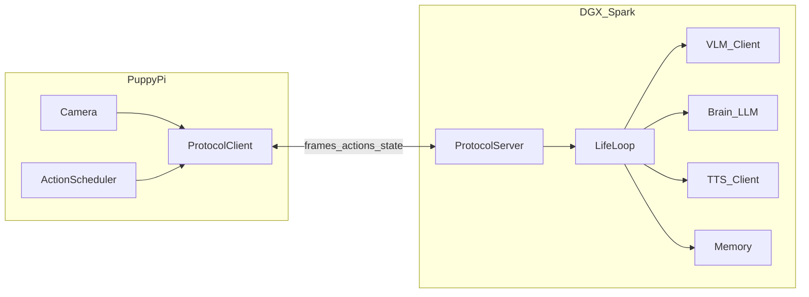
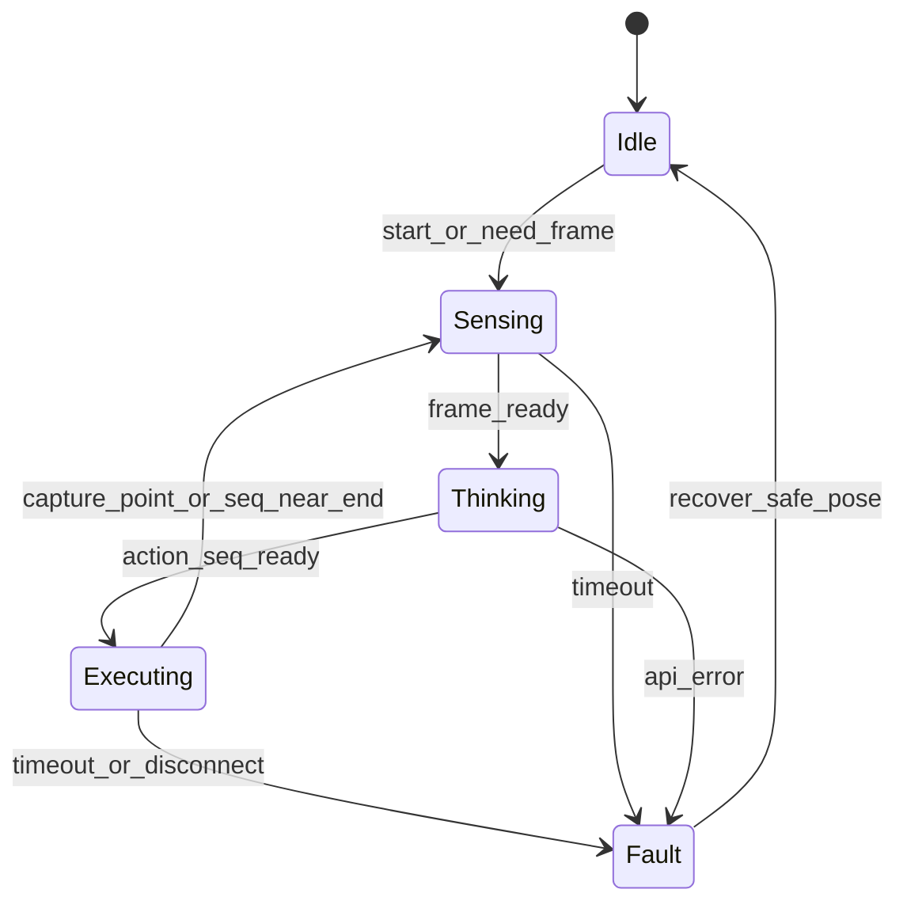

# PuppyPi 自主 Agent 设计

## 目标与边界

- **要做**：Spark 上的 agent 生命管理框架（主循环、状态机、prompt/memory、动作序列调度、与 PPI/模型的适配层）。
- **不做**：模型训练；推理框架部署；重型边端业务逻辑（边端只负责采图、按时间轴执行、回传状态）。
- **默认技术栈**：Python 3.11+；主机与 PPI 用 **WebSocket**（JSON 控制面 + 二进制图像）；VLM/LLM/TTS 均为 **OpenAI-compatible HTTP API**。

## 系统上下文



## 仓库结构（本仓库 `ppi_agent`）

```text
ppi_agent/
  protocol/          # 共享消息 schema 与编解码（主机/边端共用约定）
  agent/             # Spark：生命循环、brain、clients、server
  ppi_node/          # PuppyPi：薄客户端（采图 + 执行器 + 协议）
  configs/           # identity prompt、动作白名单、端点配置
  tests/
```

第一期以 `agent/` + `protocol/` 为主；`ppi_node/` 提供可联调的最小实现（或 mock）。

## 核心：生命循环与状态机



**主循环语义**（`agent/life_loop.py`）：

1. 从协议层取最新一帧（可丢弃过期帧，只保留最新）。
2. 调 VLM API → 结构化 `Scene`。
3. 组装 prompt：`identity` + `scene` + `recent_memory` + `action_whitelist`。
4. 调 LLM API → 校验后的 `ActionSequence`。
5. 若有台词，先 TTS → 把音频引用写入对应 `say` 动作。
6. 下发序列到 PPI；在执行期间于 `capture_at` 或序列尾部再取帧，开启下一轮，实现流水线重叠，减少发呆。
7. 更新 memory；异常则进入 Fault（下发安全姿态并退避重试）。

单轮目标时长：感知+决策尽量压在 **2–5s**；动作序列覆盖 **4–8s**，使决策延迟被执行掩盖。

## 数据契约（`protocol/`）

### Scene（VLM 输出，供 Brain 使用）

```json
{
  "summary": "客厅，前方约1m有人蹲着看镜头",
  "objects": [{"name": "person", "where": "front", "dist_m": 1.0}],
  "terrain": "indoor_flat",
  "affordances": ["approach", "greet", "sit"],
  "raw": "可选的自由文本补充"
}
```

### ActionSequence（LLM 输出，经白名单校验）

```json
{
  "seq_id": "s_042",
  "actions": [
    {"t": 0.0, "cmd": "stand", "args": {}},
    {"t": 0.4, "cmd": "say", "args": {"text": "主人好呀", "audio_ref": "aud_1"}},
    {"t": 1.0, "cmd": "move", "args": {"dir": "forward", "gait": "trot", "duration": 2.0}},
    {"t": 3.2, "cmd": "sit", "args": {}}
  ],
  "capture_at": [2.0, 4.5],
  "expires_at": 6.0
}
```

- `cmd` **只能**来自 `configs/action_whitelist.yaml`（映射 PuppyPi 手册中的真实指令名）。
- 单序列总时长硬上限（默认 8s）；非法字段直接拒收并触发一次「安全待机」序列。

### 传输消息类型

| type | 方向 | 内容 |
|------|------|------|
| `hello` / `heartbeat` | 双向 | 版本、能力、时钟 |
| `frame` | PPI→Spark | jpeg bytes + timestamp + seq |
| `robot_state` | PPI→Spark | 姿态、电量、当前执行 `seq_id`/`action_idx` |
| `action_seq` | Spark→PPI | 上文 ActionSequence |
| `audio_chunk` | Spark→PPI | TTS 音频（或先传 `audio_ref` 再拉） |
| `cancel` / `safe_pose` | Spark→PPI | 中断与故障恢复 |

编解码与帧头格式按 **PuppyPi 开发者手册** 落在 `protocol/ppi_transport.py`；上层只依赖抽象接口 `RobotTransport`（`recv_frame` / `send_action_seq` / `recv_state`），手册细节集中在一个适配器，避免污染生命循环。

## Agent 内部模块

| 模块 | 路径 | 职责 |
|------|------|------|
| LifeLoop | `agent/life_loop.py` | 状态机 + 异步主循环 |
| Vision | `agent/vision.py` | 调 VLM，解析/校验 Scene |
| Brain | `agent/brain.py` | 拼 prompt、调 LLM、解析 ActionSequence |
| Memory | `agent/memory.py` | 环形缓冲：最近 N 轮 scene + 已执行动作 |
| TTS | `agent/tts.py` | 文本→音频，回填 `audio_ref` |
| Validator | `agent/validator.py` | 白名单、时长、schema |
| Orchestrator IO | `agent/server.py` | WebSocket 服务端，实现 `RobotTransport` |
| Config | `configs/*` | 模型 endpoint、identity、白名单 |

### Prompt 组装原则

- **System**：宠物身份与行为边界（活泼、安全、不连续狂奔等）。
- **Tools/格式**：强制 JSON schema 输出 ActionSequence，禁止自由发挥指令名。
- **Context**：最近 3–5 轮「场景摘要 + 已执行序列」；过长则只留摘要。
- **本轮**：当前 Scene + 「请输出覆盖约 Ns 的下一序列，并标注 capture_at」。

## 边端最小职责（`ppi_node/`）

- 按配置分辨率/质量抓 JPEG，经协议上传（默认事件触发 + `capture_at`，而非盲目高帧率）。
- 收到 `action_seq` 后启动本地时间轴调度器：到 `t` 调手册 API 执行 `cmd`；`say` 播放对应音频。
- 周期性上报 `robot_state`；支持 `cancel` / `safe_pose`。
- **不**跑 VLM/LLM。

## 延迟与「不发呆」策略

1. 动作用**序列**而非单步，覆盖一轮推理时间。
2. 执行中在 `capture_at` 提前抓帧，Thinking 与 Executing **流水线重叠**。
3. 只保留最新帧，避免积压导致决策基于过期画面。
4. API 超时（如 8s）→ Fault → `safe_pose`，再回到 Idle。

## 配置与可运维性

- `configs/models.yaml`：VLM/LLM/TTS base_url、model、timeout。
- `configs/identity.md`：宠物人设。
- `configs/action_whitelist.yaml`：手册指令 ↔ agent `cmd` 映射。
- 结构化日志：每轮 `seq_id`、VLM/LLM 耗时、校验失败原因，便于调 prompt。

## 测试策略

- `protocol`：编解码与 schema 单测。
- `validator`：白名单/超长序列拒收。
- `life_loop`：用 mock transport + mock VLM/LLM 跑通状态迁移与流水线触发。
- 联调：`ppi_node` mock 定时吐测试图，验证闭环。

## 实施顺序

1. 定稿 `protocol` schema + `RobotTransport` 抽象。
2. 实现 `LifeLoop` + mock 依赖，单测跑通循环。
3. 接入真实 VLM/LLM/TTS HTTP client。
4. 按手册实现 WebSocket 适配器与 `ppi_node` 最小端。
5. 填 identity / whitelist，真机联调，再调流水线参数（序列时长、`capture_at`）。
