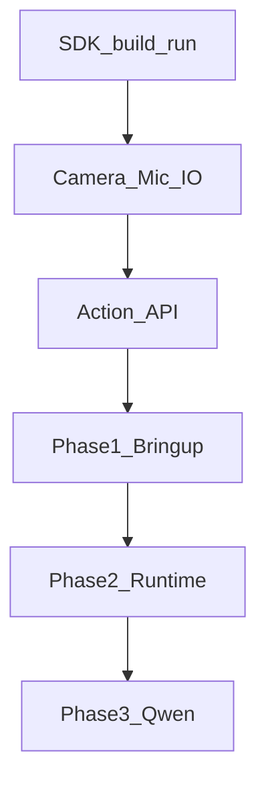

# 从零到一：Bring-up 实施计划

对齐既有设计 [design.md](design.md)。目标：三阶段结束后，PPI 能稳定 **采图 →（Qwen）感知/决策 → 动作序列执行 → 再采图**。

**默认假设**（未另说明则按此执行）：

- 联调主机优先用 **DGX Spark**（与最终部署一致）；若暂无网络/权限，可先在笔记本验证 SDK，再迁到 Spark。
- SDK / 开发者手册由你提供本地路径或官方包；仓库内用 `third_party/puppypi_sdk/`（或 git submodule）固定版本。
- Qwen：Spark 上各起一个 **OpenAI-compatible** 服务——多模态作 VLM、文本作 Brain（同一套 API 客户端）。

---

## Phase 1：环境与接口确认（阻塞后续）

产出放在 `docs/bringup.md`（检查清单 + 实测命令与结果），以及可复现的小脚本目录 `scripts/bringup/`。

**Ubuntu 本机逐步连机与接口调试**：见 [ubuntu-ppi-debug-guide.md](ubuntu-ppi-debug-guide.md)（含官方文档链接）。

### 1a. SDK 编译与上机

- 获取 PuppyPi SDK / 手册，固定到仓库可引用位置。
- 在主机确认：依赖、交叉/本机编译（按手册）、示例可编过。
- 上传到 PPI，SSH/手册方式启动官方 demo，记录：系统镜像版本、Python/ROS 版本、板端路径约定。
- **验收**：板端一条官方示例进程能启动且无崩溃；本文档记下「如何部署与启动」。

### 1b. Camera / Mic 与主机互通

- 按手册打通图像链路：主机能收到 JPEG/原始帧（分辨率、帧率、延迟记入 bringup 文档）。
- 打通音频：主机→PPI 播放试音；PPI mic→主机能收到（第一期若 mic 协议不完整，记下缺口，**不阻塞**动作闭环；语音输入可后置）。
- **验收**：主机脚本连续收图 ≥30s；下行短音频可听见。

### 1c. 触发 Action

- 从手册整理动作表 → 初稿 `configs/action_whitelist.yaml`（逻辑名 ↔ 手册指令）。
- 主机脚本依次调用：站立 / 坐下 / 前进短距 / 停止（或手册等价安全动作）。
- **验收**：三条以上动作远程触发成功；失败有明确错误回传；具备紧急停止或 `safe_pose`。

Phase 1 结束门槛：**图入、令出** 稳定，再写 runtime。

---

## Phase 2：开发 ppi runtime 框架

此处 **ppi runtime = Spark 上的生命循环 + 薄边端执行器**（见设计文档），不是在板端跑大模型。

### 主机（本仓库重点）

- `protocol/`：`Scene` / `ActionSequence` / 传输消息；`RobotTransport` 抽象。
- `agent/life_loop.py`：Idle → Sensing → Thinking → Executing → Fault 状态机。
- `agent/memory.py`、`agent/validator.py`：短记忆 + 白名单/时长校验。
- `agent/server.py`：基于 Phase 1 实测协议的 WebSocket（或手册指定通道）服务端。
- Mock VLM/LLM：返回固定 Scene / 固定动作序列，**无模型也能转圈**。

### 边端 `ppi_node/`（薄）

- 采图上传、收 `action_seq` 按时间轴调 SDK、上报 `robot_state`、响应 `cancel`/`safe_pose`。
- 尽量复用 Phase 1 bringup 脚本中的 SDK 调用，避免两套驱动。

### 验收

- mock 模式下：收图 → 出序列 → PPI 执行 → `capture_at`/序列末再收图，循环 ≥10 轮不断连。
- 单测：schema、validator、life_loop 状态迁移。

---

## Phase 3：部署 Qwen 并接入 runtime

- Spark 上部署 Qwen（VLM + LLM）为 OpenAI-compatible HTTP；写入 `configs/models.yaml`。
- 实现 `agent/vision.py` / `agent/brain.py`（替换 mock）；identity 用 `configs/identity.md`。
- TTS：若已有服务则接 `say`；否则第一期 `say` 只下发文本或跳过音频，不挡主闭环。
- **验收**：真机场景下，模型驱动的动作序列可执行；断模/超时进入 Fault → `safe_pose` 后恢复；日志含每轮耗时与 `seq_id`。

「ppi 能正常运行」的定义：**无人值守循环运行，感知与动作连续，异常可恢复**。

---

## 文档与仓库同步

- 更新 [design.md](design.md) 仅在接口与 Phase 1 实测不一致时改传输小节。
- 新增 `docs/bringup.md`：Phase 1 清单与实测结论（执行 Phase 1 时填写）。

---

## 风险与依赖

- **无 SDK/手册**：Phase 1a 无法开始；需先拿到包。
- **Mic 协议不全**：不阻塞 Phase 2/3 视觉-动作闭环。
- **动作名与手册不一致**：以 Phase 1c 实测白名单为准，Brain 只许输出白名单 `cmd`。
